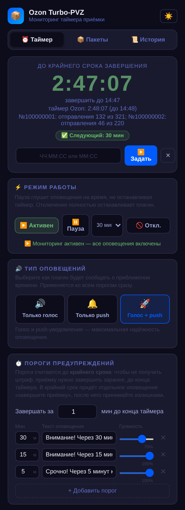
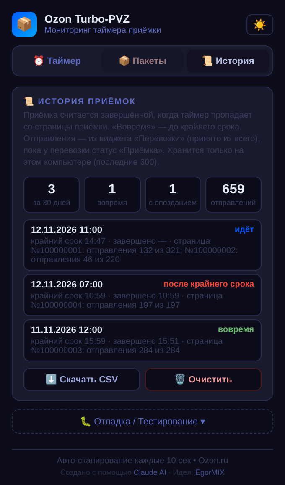
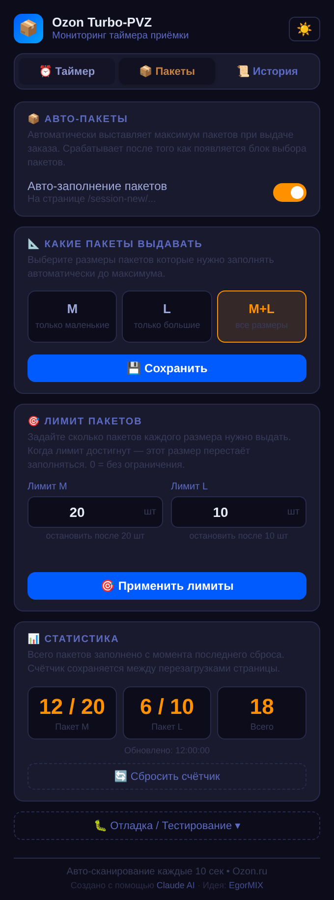
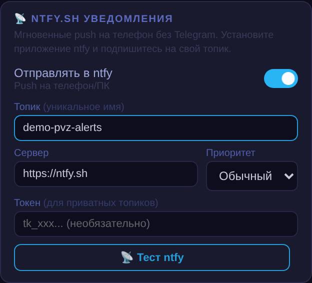

# Ozon Turbo-PVZ Timer

Расширение Chrome для сотрудников пунктов выдачи, работающих в веб-интерфейсе `turbo-pvz.ozon.ru`:

- **Таймер приёмки** — находит на странице приёмки обратный отсчёт и оповещает за 30 / 15 / 5 минут до **крайнего
  срока** — момента, когда приёмку нужно уже завершить, чтобы не получить штраф (по умолчанию за 1 минуту до конца
  таймера; дальше принимают излишками). В сам крайний срок — отдельное громкое оповещение. Каналы: голос,
  push-уведомление Chrome, Telegram и [ntfy](https://ntfy.sh). Пороги, тексты и запас настраиваются.
- **История приёмок** — когда начали, когда завершили, успели ли до крайнего срока, сколько отправлений принято
  из скольких в перевозке; выгрузка в CSV.
  В версии 1.8.0 числа обновляются прямо во время приёмки и учитывают несколько перевозок; старые пропущенные
  данные, которых расширение не сохраняло, автоматически восстановить нельзя.
- **Авто-пакеты** — на экране выдачи сам нажимает «+» у пакетов M / L до доступного количества
  (фильтр по размеру, лимиты, статистика).

> **Неофициальное расширение.** Проект не связан с Ozon, не одобрен и не поддерживается им. «Ozon» и «Turbo-PVZ» —
> названия сервиса, для которого сделано расширение. Интерфейс Ozon может измениться в любой момент — тогда расширение
> перестанет находить таймер или пакеты до обновления. Пользуйтесь на свой риск и в рамках правил вашей работы.

Создано с помощью Claude AI · Идея: EgorMIX.

## Как выглядит и что умеет

Скриншоты интерфейса версии **1.8.0** с демонстрационными данными. Нажмите на картинку, чтобы рассмотреть детали.

| Таймер и оповещения | История приёмок | Авто-пакеты |
|:---:|:---:|:---:|
| [](docs/screenshots/timer.png) | [](docs/screenshots/history.png) | [](docs/screenshots/bags.png) |

- **Таймер:** крупные цифры показывают время до крайнего срока завершения, ниже — исходный таймер Ozon и
  отправления по перевозкам. Выберите голос, push или оба канала; настройте пороги и запас времени.
- **История:** следите за текущей приёмкой и итогами прошлых, смотрите количество отправлений и выгружайте CSV
  для Excel. Числа обновляются во время работы, в сводке показаны последние 30 дней.
- **Пакеты:** включите автоматическое добавление M/L и задайте лимиты. Например, на скриншоте добавлено
  12 из 20 пакетов M и 6 из 10 пакетов L. Лимиты общие для вкладок и действуют до ручного сброса.

<details>
<summary><strong>Уведомления на телефон: пример настройки ntfy</strong></summary>

Укажите свой топик и подпишитесь на него в приложении ntfy. При необходимости выберите собственный HTTPS-сервер,
токен и приоритет. Кнопка «Тест ntfy» проверяет отправку. Топик на картинке — только пример, для работы выберите свой.
Telegram настраивается отдельно в том же окне расширения через вашего бота.



</details>

## Установка

**Из релиза (рекомендуется):**
1. Скачайте `ozon-turbo-pvz-<версия>.zip` со страницы [Releases](https://github.com/EgorMIX/ozonturbopvztool/releases)
   и распакуйте в постоянную папку (её нельзя удалять — Chrome грузит расширение оттуда).
2. Откройте `chrome://extensions`, включите «Режим разработчика».
3. «Загрузить распакованное» → выберите распакованную папку (в ней лежит `manifest.json`).
4. Обновите вкладку `turbo-pvz.ozon.ru`, если она была открыта.

**Из исходников:** то же самое, но в п. 3 выберите папку **`extension/`** этого репозитория.

Нужен Chrome 108 или новее (подойдут и другие браузеры на Chromium: Edge, Яндекс Браузер — не проверялось).

## Настройка
Нажмите на иконку расширения:
- **Таймер** — тип оповещения (голос / push / оба), пороги и их тексты, громкость, режимы «Пауза» и «Отключить».
- **Telegram** — создайте бота у [@BotFather](https://t.me/BotFather), напишите ему любое сообщение, вставьте токен
  и нажмите «Найти Chat ID».
- **ntfy** — топик (и при необходимости свой сервер `https://…` и токен). Приложение ntfy на телефоне получит
  уведомление, даже если браузер свёрнут.
- **Прокси для Telegram** — если `api.telegram.org` недоступен. Применяется только к Telegram. Логин/пароль — только для
  HTTP-прокси (SOCKS5 с логином Chrome не поддерживает); MTProto-прокси не подходят.
- **Пакеты** — включение, размеры, лимиты, сброс статистики.
  Лимиты общие для всех вкладок до ручного сброса; «Откл.» останавливает и авто-пакеты.
- **Рабочие часы** — вне смены оповещения не отправляются.
- **Обновления** — раз в день расширение проверяет, вышла ли новая версия, и показывает плашку со ссылкой на загрузку.
  Обновить: скачать zip, распаковать поверх старой папки, ⟳ на `chrome://extensions`, обновить вкладку Turbo-PVZ.
- **Резервная копия** — «Сохранить в файл» / «Загрузить из файла»: перенос настроек на другой компьютер.

Оповещения работают, пока открыт Chrome. Если вкладку приёмки закрыть, пороги всё равно сработают по таймеру, но
голос звучит только при открытой вкладке Turbo-PVZ.

## Какие права просит расширение и зачем
| Право | Зачем |
|---|---|
| `turbo-pvz.ozon.ru` | читать таймер на странице приёмки и нажимать «+» у пакетов; озвучка на этой вкладке |
| `api.telegram.org`, `ntfy.sh` | отправка оповещений в Telegram и ntfy (только если вы их включили) |
| свой сервер ntfy (необязательный доступ) | запрашивается отдельно только для выбранного HTTPS-сайта при сохранении или тесте |
| `notifications` | push-уведомления Chrome |
| `alarms` | срабатывание порогов в нужное время, даже когда вкладка «заморожена» |
| `storage` | хранение настроек и состояния таймера на вашем компьютере |
| `scripting` | запасной способ озвучки на вкладке Turbo-PVZ |
| `proxy`, `webRequest`, `webRequestAuthProvider` | прокси только для Telegram и передача логина/пароля прокси; без включённого прокси не используются |

## Приватность
Расширение не собирает и никуда не отправляет данные, кроме оповещений в каналы, которые вы сами включили. Подробно —
[PRIVACY.md](PRIVACY.md). Нашли уязвимость — [SECURITY.md](SECURITY.md).

## Разработка
Код расширения — простые файлы в `extension/`, без сборщиков и зависимостей. Команды (Node ≥ 18):
```bash
npm run check    # статическая проверка кода — после каждой правки
npm run pack     # проверка + dist/ozon-turbo-pvz-<версия>.zip
```
После правок: ⟳ у расширения на `chrome://extensions` **и** обновить вкладку Ozon (иначе в ней работает старый
content-скрипт). Логи: service worker — ссылка «Service worker» на карточке расширения; popup — ПКМ по иконке →
«Проверить всплывающее окно»; content-скрипты — консоль вкладки Ozon (`[PVZ…]`).

**Релиз:** поднять `version` в `extension/manifest.json`, дописать [CHANGELOG.md](CHANGELOG.md), смержить в `main`,
затем на GitHub: **Actions → release → Run workflow** (ветка `main`) — workflow сам создаст тег `v<версия>`, соберёт
zip и опубликует релиз. Или из терминала: `git tag v1.5.0 && git push origin v1.5.0`. Проверка `npm run check`
запускается на каждый pull request.

Документы:
- [`CLAUDE.md`](CLAUDE.md) — правила и контекст для Claude Code (проект ведётся с его помощью)
- [`docs/architecture.md`](docs/architecture.md) — как всё устроено
- [`docs/known-issues.md`](docs/known-issues.md) — известные проблемы и что уже исправлено
- [`docs/backend-idea.md`](docs/backend-idea.md) — идея серверного таймера (решение пока не принято)
- [`docs/store-listing.md`](docs/store-listing.md) — тексты и обоснования для Chrome Web Store
- [`docs/fixtures/`](docs/fixtures/) — HTML-образцы страниц Ozon для правки селекторов

Секреты (токен Telegram-бота, токен/топик ntfy, данные прокси) хранятся только в `chrome.storage.local` у
пользователя и в репозиторий не попадают. Перед тем как класть в репозиторий логи или HTML со страниц Ozon,
вырежьте всё личное (имена, телефоны, номера заказов, `access_token`).

## Лицензия
[GNU GPL v3](LICENSE).
